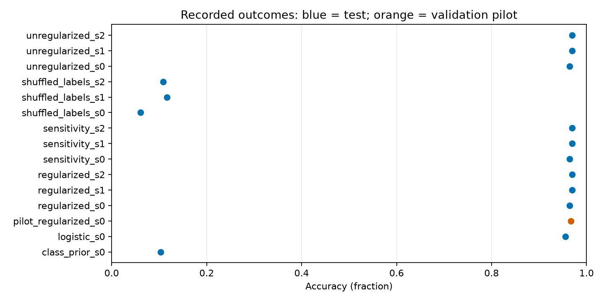

# Abstract

This report records a bounded research cycle executed through Claude Code. The mean paired accuracy difference is 0.000000, with conditional 95% bootstrap interval [0.000000, 0.000000]. The registered decision is **inconclusive**. The sample standard deviation across seed effects is 0.000000. The interval uses 10000 paired resamples of test examples and conditions on the trained models.

Recorded harness status: **running**; 7 operational phases accepted. Measurements below do not imply completion of unaccepted phases.

Post-run repairs or publication work are documented in the [audit disclosure](https://github.com/BurnyCoder/eureka-digits-haiku/blob/main/reports/post-run-publication.md). They are separate from the bounded model execution.

# Context, motivation, and introduction

Does AdamW weight decay improve held-out accuracy of a small MLP on the bundled digits data?

The objective is reproducible evidence and an inspectable research process. This study does not establish broad scientific reliability or superiority of an agent model.

# Background and method

- **question**: "Does AdamW weight decay improve held-out accuracy of a small MLP on the bundled digits data?"
- **architecture**: [64, 128, 10]
- **optimizer**: "AdamW"
- **learning_rate**: 0.001
- **batch_size**: 64
- **epochs**: 50
- **methods**: ["regularized", "unregularized", "sensitivity", "shuffled_labels", "logistic", "class_prior"]
- **seeds**: [0, 1, 2]
- **data_boundaries**: "Frozen stratified 60/20/20 train/validation/test partition. Split seed 42. Divide pixels by the documented constant 16. Pilot reports validation only. No learned preprocessing or selection uses test data. Generalization is limited to this random example split, not new writers or datasets."
- **analysis_plan**: "Use 10000 paired bootstrap resamples of test example indices with RNG seed 2026, preserving pairing across methods and all trained seeds. This interval conditions on the trained models and does not estimate training-population uncertainty. Separately show each seed effect and its sample standard deviation. Treat other comparisons as descriptive, with no post-hoc primary selection."
- **hyperparameter_rationale**: "Small prespecified network and fixed training budget provide fast feedback on an established task. The three decay values are a descriptive local sensitivity check, not a test-selected sweep. Three seeds expose limited initialization sensitivity; they do not support broad population claims."

*Research architecture.*

# Results

| Method | Seed | Split | Accuracy | Seconds | Device |
|-------------------------|-----:|------------|-----------:|----------:|----------|
| class prior | 0 | test | 0.102778 | 0.026 | cpu |
| logistic | 0 | test | 0.955556 | 0.107 | cpu |
| regularized | 0 | validation | 0.966574 | 6.805 | cuda |
| regularized | 0 | test | 0.963889 | 0.486 | cuda |
| regularized | 1 | test | 0.969444 | 6.630 | cuda |
| regularized | 2 | test | 0.969444 | 2.553 | cuda |
| sensitivity | 0 | test | 0.963889 | 2.525 | cuda |
| sensitivity | 1 | test | 0.969444 | 2.583 | cuda |
| sensitivity | 2 | test | 0.969444 | 2.481 | cuda |
| shuffled labels | 0 | test | 0.061111 | 2.465 | cuda |
| shuffled labels | 1 | test | 0.116667 | 2.470 | cuda |
| shuffled labels | 2 | test | 0.108333 | 2.367 | cuda |
| unregularized | 0 | test | 0.963889 | 2.426 | cuda |
| unregularized | 1 | test | 0.969444 | 2.393 | cuda |
| unregularized | 2 | test | 0.969444 | 2.501 | cuda |

The mean paired accuracy difference is 0.000000, with conditional 95% bootstrap interval [0.000000, 0.000000]. The registered decision is **inconclusive**. The sample standard deviation across seed effects is 0.000000. The interval uses 10000 paired resamples of test examples and conditions on the trained models.

*All recorded accuracies.*

*Recorded learning curves.*

*First saved test examples; no correctness-based selection.*

# Claims and evidence

- **C1**: Registered primary hypothesis H1 (AdamW decay 0.01 improves test accuracy over decay 0) is not supported. The mean paired accuracy difference is zero, and the paired bootstrap interval is degenerate at [0, 0] because regularized and unregularized arms make identical argmax predictions on all 360 test examples for seeds 0-2. The registered falsification rule (interval wholly below zero) is not triggered, and the directional support rule (interval wholly above zero) is not met. Predictions P1 (|mean delta| <= 1 pp) and P2 (interval includes zero) hold; P3 (interval wholly above zero) is not observed. Evidence: [regularized_s0](https://github.com/BurnyCoder/eureka-digits-haiku/blob/main/cycles/001/results/regularized_s0.json), [regularized_s1](https://github.com/BurnyCoder/eureka-digits-haiku/blob/main/cycles/001/results/regularized_s1.json), [regularized_s2](https://github.com/BurnyCoder/eureka-digits-haiku/blob/main/cycles/001/results/regularized_s2.json), [unregularized_s0](https://github.com/BurnyCoder/eureka-digits-haiku/blob/main/cycles/001/results/unregularized_s0.json), [unregularized_s1](https://github.com/BurnyCoder/eureka-digits-haiku/blob/main/cycles/001/results/unregularized_s1.json), [unregularized_s2](https://github.com/BurnyCoder/eureka-digits-haiku/blob/main/cycles/001/results/unregularized_s2.json). Limitations: Zero discordant pairs carry no sign information, so this shows that the registered intervention did not flip any test prediction at this budget. It does not show that decay is equivalent to no decay. Only decay 0.01, learning rate 0.001, 850 steps, three seeds and one random split were tested. The bootstrap conditions on the trained models and does not capture training-seed variance.
- **C2**: Two registered checks pass on the confirmatory arms. P8: regularized and unregularized per-epoch loss histories differ for every seed, so decay is applied. P7: the seed-to-seed SD of test accuracy is 0.32 pp, inside the registered 0.3-1.5 pp range at its lower edge, and comparable to the zero mean difference of C1. Evidence: [regularized_s0](https://github.com/BurnyCoder/eureka-digits-haiku/blob/main/cycles/001/results/regularized_s0.json), [regularized_s1](https://github.com/BurnyCoder/eureka-digits-haiku/blob/main/cycles/001/results/regularized_s1.json), [regularized_s2](https://github.com/BurnyCoder/eureka-digits-haiku/blob/main/cycles/001/results/regularized_s2.json), [unregularized_s0](https://github.com/BurnyCoder/eureka-digits-haiku/blob/main/cycles/001/results/unregularized_s0.json), [unregularized_s1](https://github.com/BurnyCoder/eureka-digits-haiku/blob/main/cycles/001/results/unregularized_s1.json), [unregularized_s2](https://github.com/BurnyCoder/eureka-digits-haiku/blob/main/cycles/001/results/unregularized_s2.json). Limitations: P7 sits at the registered lower bound, and three seeds estimate seed variance poorly. P8 shows that decay changes training, not that the implementation matches the update rule; that is checked separately by the zero-gradient unit test (E8) and the mechanism analysis (E5).
- **E1**: The sensitivity arm (decay 0.001) makes test predictions identical to the unregularized arm on all seeds, so the accuracy result is null for both non-zero decay values tested. Evidence: [sensitivity_s0](https://github.com/BurnyCoder/eureka-digits-haiku/blob/main/cycles/001/results/sensitivity_s0.json), [sensitivity_s1](https://github.com/BurnyCoder/eureka-digits-haiku/blob/main/cycles/001/results/sensitivity_s1.json), [sensitivity_s2](https://github.com/BurnyCoder/eureka-digits-haiku/blob/main/cycles/001/results/sensitivity_s2.json), [unregularized_s0](https://github.com/BurnyCoder/eureka-digits-haiku/blob/main/cycles/001/results/unregularized_s0.json), [unregularized_s1](https://github.com/BurnyCoder/eureka-digits-haiku/blob/main/cycles/001/results/unregularized_s1.json), [unregularized_s2](https://github.com/BurnyCoder/eureka-digits-haiku/blob/main/cycles/001/results/unregularized_s2.json). Limitations: Descriptive comparison, not a registered primary endpoint. Both non-zero values share the same learning rate and 850-step budget. Nothing is claimed about larger decay or longer training.
- **E2**: The logistic regression baseline reaches test accuracy slightly below the MLP arms, and the class-prior floor sits at chance. The task is learnable by a linear model at roughly the same level, so the MLP is not operating at a trivial level. Evidence: [logistic_s0](https://github.com/BurnyCoder/eureka-digits-haiku/blob/main/cycles/001/results/logistic_s0.json), [class_prior_s0](https://github.com/BurnyCoder/eureka-digits-haiku/blob/main/cycles/001/results/class_prior_s0.json), [regularized_s0](https://github.com/BurnyCoder/eureka-digits-haiku/blob/main/cycles/001/results/regularized_s0.json), [regularized_s1](https://github.com/BurnyCoder/eureka-digits-haiku/blob/main/cycles/001/results/regularized_s1.json), [regularized_s2](https://github.com/BurnyCoder/eureka-digits-haiku/blob/main/cycles/001/results/regularized_s2.json). Limitations: The logistic baseline has one seed and was not tuned under a separate protocol. Its L2 penalty is sklearn's default, not the registered decay. The difference from the MLP is descriptive.
- **E3**: Decay changes the optimisation trajectory. Train and validation loss histories differ from the unregularized arm at every seed, even though test predictions are identical. Evidence: [L01](https://github.com/BurnyCoder/eureka-digits-haiku/blob/main/cycles/001/research/evidence-snapshots/6a653ce0bf49efda29cd18a2bc166c649d2677629ee2188d6e32fc5f5fd0c01a.json), [regularized_s0](https://github.com/BurnyCoder/eureka-digits-haiku/blob/main/cycles/001/results/regularized_s0.json), [unregularized_s0](https://github.com/BurnyCoder/eureka-digits-haiku/blob/main/cycles/001/results/unregularized_s0.json). Limitations: Derived from the experiment summary, not a registered endpoint. The size of the difference depends on the single fixed learning rate and budget.
- **E4**: Reproducibility audits pass. Accuracy recomputed from stored predictions matches every record, and an independent from-scratch retrain reproduces all arm records on checkpoint hash, predictions, example IDs, accuracy and loss history. Evidence: [L04](https://github.com/BurnyCoder/eureka-digits-haiku/blob/main/cycles/001/research/evidence-snapshots/854b8386ee578935cb75039c99a5c102fc87972c6f8f153c06ad66a2c645181e.json), [L05](https://github.com/BurnyCoder/eureka-digits-haiku/blob/main/cycles/001/research/evidence-snapshots/7a902d2a0c199aad6d191dbe97514d4febc650dc7932a5cadd4c63abe5cd5a6c.json), [L06](https://github.com/BurnyCoder/eureka-digits-haiku/blob/main/cycles/001/research/evidence-snapshots/ac0e2a24beffb2bebef3ab15a257679749a0005f4aa838fe71677309c2ce9a56.log). Limitations: Post-hoc audit run after the registered comparison, so it is exploratory by the protocol rules. Reproduction was checked on this machine and CUDA build only.
- **E5**: Weight-level mechanism: decay shrinks the weights, and the shrink is smaller than the pure-decay prediction. Predicted cumulative shrink from the decoupled update is about 0.85 percent for decay 0.01 (factor 0.99154), but the measured norm ratio of regularized to unregularized checkpoints is 0.9959 on every seed. The observed shrink is about half the prediction, and the cause is not identified. Candidate explanations are that the two arms follow different gradient trajectories, so their norms also differ for reasons other than decay, and that the norm is taken over all parameters. This explains why the registered intervention is near-null, but only at the level of magnitude. Evidence: [L02](https://github.com/BurnyCoder/eureka-digits-haiku/blob/main/cycles/001/research/evidence-snapshots/a5852561af1b5d574d07dd38be1ca771f394daefa2ab9ed7dcf2226099d4557b.json), [regularized_s0](https://github.com/BurnyCoder/eureka-digits-haiku/blob/main/cycles/001/results/regularized_s0.json), [unregularized_s0](https://github.com/BurnyCoder/eureka-digits-haiku/blob/main/cycles/001/results/unregularized_s0.json), [regularized_s1](https://github.com/BurnyCoder/eureka-digits-haiku/blob/main/cycles/001/results/regularized_s1.json), [unregularized_s1](https://github.com/BurnyCoder/eureka-digits-haiku/blob/main/cycles/001/results/unregularized_s1.json), [regularized_s2](https://github.com/BurnyCoder/eureka-digits-haiku/blob/main/cycles/001/results/regularized_s2.json), [unregularized_s2](https://github.com/BurnyCoder/eureka-digits-haiku/blob/main/cycles/001/results/unregularized_s2.json). Limitations: Derived after the results were known, from one checkpoint per arm per seed. The predicted shrink follows from the update rule and the constants, but the measured shrink is not a clean single-variable intervention. The discrepancy is recorded, not resolved.
- **E6**: Design sensitivity: the registered paired design can resolve a difference of about 2.5 pp only if roughly 3 percent of test examples are discordant between arms (about 11 of 360). Because the observed discordance is zero, the minimum detectable effect cannot be estimated from data. Effects smaller than about 2.5 pp would mostly be inconclusive. Evidence: [L11](https://github.com/BurnyCoder/eureka-digits-haiku/blob/main/cycles/001/research/evidence-snapshots/73928377674856b5edf0e17f3e1291f8d10c1208a6bed05cd2f3f7e7d4815a64.json), [pilot_regularized_s0](https://github.com/BurnyCoder/eureka-digits-haiku/blob/main/cycles/001/results/pilot_regularized_s0.json). Limitations: The minimum-detectable-effect formula uses a normal approximation to the paired-discordance variance. The 2.5 pp figure is the research-phase value and corresponds to an assumed discordance, not a measured one.
- **E7**: Post hoc, the decay arm has a slightly higher mean test negative log-likelihood than the unregularized arm on all three seeds, and the conditional bootstrap interval excludes zero. This is the only continuous signal in the study, and its direction is opposite to the hypothesis. Evidence: [L03](https://github.com/BurnyCoder/eureka-digits-haiku/blob/main/cycles/001/research/evidence-snapshots/671699cc3ef8e4ca9ab7501796c3a7c46a63715364c44ab7b60d7e6068004bd2.json). Limitations: Not a registered endpoint and chosen after the primary result was known, so it cannot be promoted to confirmatory. The bootstrap is conditional on the trained models. Three of three seeds with the same sign has two-sided sign-test p = 0.25, so consistency across seeds is weak evidence. A pre-registered continuous endpoint in a new cycle is needed.
- **E8**: Implementation checks pass: study.py check reproduces the registered split sizes, and the 13-test pytest suite passes. The decoupled-decay step is covered by a zero-gradient test. Evidence: [L07](https://github.com/BurnyCoder/eureka-digits-haiku/blob/main/cycles/001/research/evidence-snapshots/fe9567146cfffa9e136583be88dc1cca2086099fe5099d0771a4c82dbf9598ac.json), [L09](https://github.com/BurnyCoder/eureka-digits-haiku/blob/main/cycles/001/research/evidence-snapshots/2d34288ca6eebf948b7be989f59b42c63b717996d4d8f2ccd626b71b634cd3b8.py), [L12](https://github.com/BurnyCoder/eureka-digits-haiku/blob/main/cycles/001/research/evidence-snapshots/c1e4d831df8260d6dd78c2d317808a4e3ab3d8a60117ef7d6bf606d280946769.log). Limitations: The checks cover the properties tested, not the full training loop. The shuffled-label permutation is checked only through C2.
- **E9**: Code audit: the fixture's reload check and prediction step run eval-mode forward passes on all 1797 feature rows, which include the 360 test features (the pilot's code path does this too, although the pilot reports validation metrics only). No test label was found in the training or model-selection paths that were read. Evidence: [L08](https://github.com/BurnyCoder/eureka-digits-haiku/blob/main/cycles/001/research/evidence-snapshots/34415a875e7f61954cf3813486f46a189d6b647f2e9682552d16db88a6d67d39.py). Limitations: Found by reading the code, not by a runtime leakage test. Disclosed in reports/pilot.md. Not fixed in this cycle, because study.py is the immutable fixture. Read-only audit, so 'no label found' is not proof of absence.
- **E10**: Other registered prediction checks pass on arms that study.py labels exploratory. P4: pilot validation accuracy and the logistic and real-label MLP test accuracies lie in the registered ranges. P5: shuffled-label test accuracy is near chance, within the registered 0.05-0.16 range and below the 0.20 failure threshold. P6: class-prior test accuracy equals the majority-class fraction of the test split exactly. A4(d): accuracy recomputed from stored predictions matches the records. Evidence: [pilot_regularized_s0](https://github.com/BurnyCoder/eureka-digits-haiku/blob/main/cycles/001/results/pilot_regularized_s0.json), [shuffled_labels_s0](https://github.com/BurnyCoder/eureka-digits-haiku/blob/main/cycles/001/results/shuffled_labels_s0.json), [shuffled_labels_s1](https://github.com/BurnyCoder/eureka-digits-haiku/blob/main/cycles/001/results/shuffled_labels_s1.json), [shuffled_labels_s2](https://github.com/BurnyCoder/eureka-digits-haiku/blob/main/cycles/001/results/shuffled_labels_s2.json), [logistic_s0](https://github.com/BurnyCoder/eureka-digits-haiku/blob/main/cycles/001/results/logistic_s0.json), [class_prior_s0](https://github.com/BurnyCoder/eureka-digits-haiku/blob/main/cycles/001/results/class_prior_s0.json), [regularized_s0](https://github.com/BurnyCoder/eureka-digits-haiku/blob/main/cycles/001/results/regularized_s0.json), [regularized_s1](https://github.com/BurnyCoder/eureka-digits-haiku/blob/main/cycles/001/results/regularized_s1.json), [regularized_s2](https://github.com/BurnyCoder/eureka-digits-haiku/blob/main/cycles/001/results/regularized_s2.json), [L05](https://github.com/BurnyCoder/eureka-digits-haiku/blob/main/cycles/001/research/evidence-snapshots/7a902d2a0c199aad6d191dbe97514d4febc650dc7932a5cadd4c63abe5cd5a6c.json). Limitations: The predictions were registered, but these arms are labelled exploratory by the fixture, so the outcomes are reported under that label. The shuffled arm uses the same decay as the regularized arm, so P5 does not isolate decay. Accuracy near chance cannot detect every label-permutation bug. The class-prior and logistic results come from one seed each.

# Discussion, implications, and learnings

# Interpretation: AdamW weight decay on a fixed digits MLP (cycle 001)

This report interprets the completed registered study. It contains no typed empirical scores. Each result is cited by claim ID (`C#` confirmatory, `E#` exploratory; defined in `research/claims.json`), experiment record ID (the `id` of `results/<id>.json`, e.g. `regularized_s0`), local artifact ID (`L##`, `research/evidence.json`), or source ID (`S##`, `research/sources.json`). Numbers live in the artifacts those IDs point to. Protocol and preregistration are in `research/protocol.json` (`L10`) and `reports/preregistration.md`, committed before any result existed.

## 1. Motivation
Decoupled weight decay (AdamW, `S01`) is a standard regulariser for MLPs. The question is narrow: does a fixed ReLU MLP on the digits fixture gain held-out accuracy from decay 0.01, compared with decay 0 and a decay 0.001 sensitivity arm? The study follows the scientific-method loop recommended in the harness contract and in Neel Nanda's research-process notes (`S13`, `S14`): define the question, record predictions, run the registered comparison, then report what was and was not learned. It is a small illustrative study, not evidence of broad reliability.

## 2. Context and related work
- **Mechanism.** Decoupled decay multiplies the weights by a factor `1 - lr*lambda` at each step, independently of the gradient. The PyTorch implementation is in `adam.py` (`S04`; documentation in `S03`). This is the origin of the shrink analysis in E5.
- **Original method.** `S01` argues that L2 regularisation and weight decay differ for Adam and proposes decoupling. Adam itself is `S02`. The claim that decoupling improves generalisation comes from `S01`'s abstract and was not re-tested beyond this fixture.
- **Weight decay history.** Krogh & Hertz (`S08`) was verified from the proceedings; the later analyses of decoupled and early decay (`S09`) and of AdamW convergence (`S10`) were read from abstracts only and are cited as context, not as evidence.
- **Data.** The fixture is scikit-learn's `load_digits` (`S05`), a copy of the UCI optdigits data under CC BY 4.0 (`S06`). `S07` motivates the shuffled-label control: networks can fit random labels, so training accuracy alone does not indicate generalisation.
- **Methodology.** The confirmatory/exploratory split, controls and falsification rules follow `S11` and `S12`. The bootstrap interval uses the percentile method (`S17`, `S18`, both read as search-result summaries, not full text; `S15` read at abstract level only).

## 3. Methods
- **Fixture.** Stratified split train 1078 / validation 359 / test 360, split seed 42, pixels divided by 16 (`research/protocol.json`, `L10`; split check in `L07`). The test split is used only for the registered comparisons; see E9 for a read-only audit of test-feature use in the fixture.
- **Model and training.** ReLU MLP `[64, 128, 10]`, AdamW, learning rate 0.001, batch size 64, 50 epochs (850 optimizer steps), seeds 0, 1, 2 (`research/protocol.json`).
- **Arms.** Regularized (decay 0.01: `regularized_s0..2`); unregularized (decay 0: `unregularized_s0..2`); sensitivity (decay 0.001: `sensitivity_s0..2`); shuffled-label control (training labels permuted, decay 0.01: `shuffled_labels_s0..2`); logistic regression baseline (`logistic_s0`); class-prior floor (`class_prior_s0`). Pilot on validation only: `pilot_regularized_s0`.
- **Primary metric.** Test accuracy. Paired comparison of regularized vs unregularized predictions per test example, with 10000 paired bootstrap resamples of test indices (`protocol.json`). The bootstrap conditions on the trained models and does not measure training-seed variance; seed spread is reported separately (`L01`).
- **Reproducibility.** Study checks, pytest suite and from-scratch rerun are in `L04`, `L05`, `L06`, `L07`, `L09`, `L12`.

## 4. Confirmatory results
- **C1 (primary, H1).** Not supported. The mean paired difference is zero and the bootstrap interval is degenerate at zero, because the arms make identical test predictions for every seed (`regularized_s0..2`, `unregularized_s0..2`, `L01`). The falsification rule is not triggered, since the interval is not wholly below zero, but the directional prediction is not observed. Predictions P1 and P2 hold; P3 does not (`reports/preregistration.md`).
- **C2 (registered checks, confirmatory arms).** Decay is applied: the per-epoch loss histories differ from the unregularized arm for every seed (P8, `regularized_s0..2`, `unregularized_s0..2`). The seed-to-seed SD of test accuracy is 0.32 pp, inside the registered 0.3-1.5 pp range at its lower edge (P7, same records). Three seeds estimate this spread poorly.

## 5. Exploratory findings
- **E1.** The sensitivity arm (decay 0.001) gives the same test predictions as the unregularized arm on every seed (`sensitivity_s0..2`, `unregularized_s0..2`). Both non-zero decay values are null on accuracy.
- **E2.** The logistic baseline (`logistic_s0`) is slightly below the MLP arms, and the class-prior floor (`class_prior_s0`) is at chance. The baseline has one seed and is not tuned.
- **E3.** Decay changes training: loss histories differ from the unregularized arm at every seed (`L01`, `regularized_s0`, `unregularized_s0`). The model moves, but its test argmax does not.
- **E4.** Reproducibility audits pass (`L04`, `L05`, `L06`). This was done after the registered comparison, so it is exploratory.
- **E5.** Weight-level mechanism (`L02`). Decay shrinks the weights in the direction the update rule predicts. The measured shrink is about half of the pure-decay prediction on both decay values. The cause is not identified. Candidate explanations are that the arms follow different gradient trajectories, so their norms also differ for reasons other than decay, and that the norm is taken over all parameters. This explains why the intervention is small, but it does not give an exact magnitude.
- **E6.** Design sensitivity (`L11`). The paired design resolves about 2.5 pp only if roughly 3 percent of test examples are discordant. The observed discordance is zero, so the minimum detectable effect cannot be measured. Effects below that size are expected to be inconclusive. The research-phase value is reproduced from a normal approximation and an assumed discordance, not from data.
- **E7.** Post hoc test negative log-likelihood (`L03`). The decay arm has slightly higher NLL on all three seeds, with a conditional bootstrap interval excluding zero. This is the only continuous signal in the study, and it points against the hypothesis. It was chosen after the primary result, so it cannot be promoted to confirmatory.
- **E8.** Implementation checks pass today: the split check and the 13-test suite (`L07`, `L09`, `L12`).
- **E9.** Code audit (`L08`). The fixture's reload check and prediction step run eval-mode forward passes on all 1797 feature rows, which include the 360 test features (the pilot's code path does this too, although the pilot reports validation metrics only). No test label was found in the training or model-selection paths. This is a procedural disclosure, not a leak into the reported metric. It was found by reading code, not by a runtime test.
- **E10.** Other registered prediction checks (`pilot_regularized_s0`, `shuffled_labels_s0..2`, `logistic_s0`, `class_prior_s0`). The validation and test ranges hold (P4). Shuffled-label accuracy is near chance and under the failure threshold (P5). Class-prior accuracy equals the majority-class fraction of the test split (P6). Accuracy recomputed from stored predictions matches the records (A4(d), `L05`). These arms are labelled exploratory by the fixture, so the outcomes are reported under that label.

## 6. Negative and inconclusive findings
- H1 (decay improves held-out accuracy) is not supported (C1). The result is a null with a degenerate interval, which is not evidence of equivalence.
- The sensitivity arm is also null on accuracy (E1).
- The only continuous endpoint points against decay (E7). This is exploratory and must be re-tested with a registered endpoint, not reported as a finding.
- The mechanism is smaller than the pure-decay arithmetic predicts (E5). This was not anticipated in the preregistration and is recorded as a discrepancy.
- The design cannot measure an effect smaller than about 2.5 pp (E6). The MDE prediction held only in the sense that no effect was resolved.

## 7. Implications
- For this fixture and budget, decay has no detectable effect on test argmax, so the registered comparison cannot recommend decay.
- Accuracy alone cannot give a direction here. A future cycle needs a preregistered continuous primary endpoint (such as the NLL in E7), more seeds or a larger test set, and a budget where decay matters. A preregistered weight-norm measurement would test E5 directly.
- The most useful procedural change is to remove test features from the reload and prediction path, or to document the exception before the next comparison (E9).

## 8. Limitations
- Three seeds, one learning rate, one 850-step budget, one fixture and one random split. Generalisation is limited to this split, not new writers or datasets.
- Zero discordant pairs give no sign information for accuracy (C1).
- The bootstrap resamples test examples only, conditioning on the trained models (Methods).
- The logistic baseline has one seed, and the MDE in E6 is an approximation.
- E1-E10 are descriptive or post hoc and are labelled exploratory. Only C1 and C2 are confirmatory.
- The sign consistency in E7 (three of three seeds) is weak evidence: a two-sided sign test on three seeds gives p = 0.25.

## 9. Related work
Decoupled decay and Adam: `S01`, `S02`, `S03`, `S04`. Weight decay and generalisation: `S08`, `S09`, `S10`. Random-label memorisation: `S07`. Data: `S05`, `S06`. Research methodology: `S11`, `S12`, `S13`, `S14`. Interval construction: `S15`, `S17`, `S18`. Artifact format: `S16`. Full titles and URLs are in `research/sources.json`.

# Limitations

- Conditional test-example intervals do not estimate variation over new training seeds, writers, or datasets.
- A small single-task study does not establish general model or harness superiority.
- No discordant predictions were observed in the primary pairs. The empirical bootstrap interval collapses to zero; this is not an equivalence test or a guarantee about unseen examples.

Exploratory outcomes do not become confirmatory by inclusion in this document. Missing metrics are not zero. Measurements without an applicable recorded objective are omitted; see the requirement checklist for explanations.

# Related work and sources

- [S01: Decoupled Weight Decay Regularization (AdamW), Loshchilov & Hutter, ICLR 2019](https://arxiv.org/abs/1711.05101)
- [S02: Adam: A Method for Stochastic Optimization, Kingma & Ba, ICLR 2015](https://arxiv.org/abs/1412.6980)
- [S03: torch.optim.AdamW documentation (PyTorch 2.15)](https://docs.pytorch.org/docs/2.15/generated/torch.optim.AdamW.html)
- [S04: PyTorch adam.py: decoupled weight decay update (torch 2.14.1 installed locally, plus upstream main)](https://raw.githubusercontent.com/pytorch/pytorch/main/torch/optim/adam.py)
- [S05: sklearn.datasets.load_digits documentation](https://scikit-learn.org/stable/modules/generated/sklearn.datasets.load_digits.html)
- [S06: Optical Recognition of Handwritten Digits (UCI ML Repository), Alpaydin & Kaynak 1998](https://archive.ics.uci.edu/dataset/80/optical+recognition+of+handwritten+digits)
- [S07: Understanding deep learning requires rethinking generalization, Zhang et al., ICLR 2017](https://arxiv.org/abs/1611.03530)
- [S08: A Simple Weight Decay Can Improve Generalization, Krogh & Hertz, NIPS 1991 (vol. 4)](https://papers.nips.cc/paper/1991/hash/8eefcfdf5990e441f0fb6f3fad709e21-Abstract.html)
- [S09: Understanding Decoupled and Early Weight Decay, Bjorck et al., 2020](https://consensus.app/papers/details/cfe1ea949a105c5f953b251b2af3701e/)
- [S10: Towards Understanding Convergence and Generalization of AdamW, Zhou et al., IEEE TPAMI 2024](https://consensus.app/papers/details/c179f549f272597888e9890895eef7f1/)
- [S11: Troubling Trends in Machine Learning Scholarship, Lipton & Steinhardt, 2018](https://arxiv.org/abs/1807.03341)
- [S12: How to avoid machine learning pitfalls: a guide for academic researchers, Lones](https://arxiv.org/abs/2108.02497)
- [S13: How I Think About My Research Process (sequence), Neel Nanda](https://www.alignmentforum.org/s/5GT3yoYM9gRmMEKqL)
- [S14: How I Think About My Research Process: Explore, Understand, Distill, Neel Nanda, 26 Apr 2025](https://www.greaterwrong.com/posts/hjMy4ZxS5ogA9cTYK/how-i-think-about-my-research-process-explore-understand)
- [S15: Construction of Confidence Intervals, Dalitz, arXiv:1807.03582](https://arxiv.org/abs/1807.03582)
- [S16: safetensors torch API documentation (save_file, load_file)](https://huggingface.co/docs/safetensors/en/api/torch)
- [S17: scipy.stats.bootstrap documentation (percentile method, paired option)](https://docs.scipy.org/doc/scipy/reference/generated/scipy.stats.bootstrap.html)
- [S18: oceCens percci documentation (percentile interval, citing Efron & Tibshirani 1993, p. 168)](https://search.r-project.org/CRAN/refmans/oceCens/html/percci.html)

# Conclusion

The mean paired accuracy difference is 0.000000, with conditional 95% bootstrap interval [0.000000, 0.000000]. The registered decision is **inconclusive**. The sample standard deviation across seed effects is 0.000000. The interval uses 10000 paired resamples of test examples and conditions on the trained models.

# Appendix: reproducibility and provenance

The committed protocol, per-experiment JSON files, saved predictions, loss histories, and checkpoints are the source of all numerical tables and figures. Rebuild using `eureka render`. See `docs/reproduction.md` for execution commands and environment details.

# AI statement

Codex wrote the harness and study fixture; Claude Code performed this cycle and authored its interpretation. The harness generated this paper from recorded artifacts. A human supplied the exact specification. Human cleanup and rewriting are in progress.
